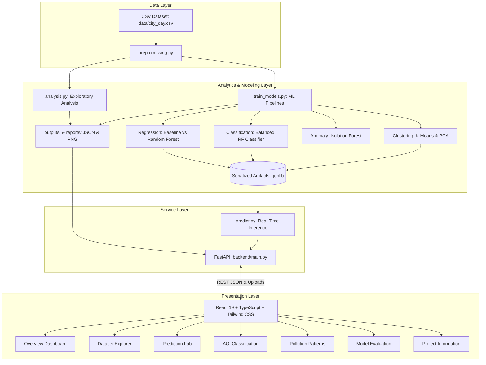

# AIRGUARD: AIR POLLUTION MONITORING AND PREDICTIVE ANALYTICS SYSTEM USING MACHINE LEARNING

**Course Domain:** Essentials of Data Science / Machine Learning Applications  
**Project Classification:** Full-Stack Environmental Data Science Mini-Project  
**Status:** Implementation Complete & Production-Ready  

---

## 1. TITLE
**AirGuard: Air Pollution Monitoring and Predictive Analytics System Using Machine Learning**

---

## 2. ABSTRACT
Urban atmospheric pollution, characterized primarily by elevated ambient concentrations of respirable particulate matter ($\text{PM}_{2.5}$ and $\text{PM}_{10}$) alongside toxic gaseous precursors ($\text{NO}_2$, $\text{SO}_2$, $\text{CO}$, $\text{O}_3$), represents a catastrophic global public health hazard. Existing environmental monitoring stations maintain retrospective historical logs, yet frequently lack integrated automated mechanisms to forecast imminent exposure risks, identify multivariate environmental pollution regimes, or audit severe data missingness.

This project delivers **AirGuard**, an end-to-end data science application engineered with Python, Scikit-Learn, FastAPI, React, and Tailwind CSS. The system implements:
1. Automated CSV discovery, schema validation, and missing-value profiling.
2. Exploratory time-series and correlation analysis with non-parametric outlier detection.
3. Chronological time-series forecasting for $\text{PM}_{2.5}$ comparing Ordinary Least Squares (OLS) Linear Regression baseline against a Random Forest Regressor using engineered chronological lag features.
4. Multiclass air quality bucket classification strictly preventing target leakage by isolating raw ambient pollutant features from mathematical AQI derivations.
5. Unsupervised K-Means clustering with optimal $K$ silhouette score evaluation and two-dimensional Principal Component Analysis (PCA) projection.
6. Isolation Forest anomaly detection identifying statistical environmental outliers.

The entire architecture is served through a validated REST API and presented via a high-performance, dark-themed responsive analytics web application with zero synthetic data fabrication.

---

## 3. INTRODUCTION
Air quality degradation in developing and industrialized urban centers has escalated into a chronic ecological crisis. Atmospheric monitoring initiatives governed by statutory bodies (e.g., Central Pollution Control Board in India, EPA internationally) deploy continuous ambient air quality monitoring stations (CAAQMS). These sensors generate high-dimensional multivariate time-series datasets tracking particulate matter and gaseous compounds on an hourly or daily interval.

However, raw telemetry from sensor networks exhibits significant real-world challenges:
- High percentages of missing observations caused by sensor recalibration and communication dropouts.
- Severe seasonal variances driven by meteorological conditions (thermal inversions in winter vs. monsoon dispersion).
- Lack of interactive tools enabling environmental scientists and the public to model prospective pollution trajectories.

AirGuard addresses these imperatives by bridging mathematical data science theory and software engineering practice.

---

## 4. PROBLEM STATEMENT
Current environmental monitoring platforms suffer from three distinct technical limitations:
1. **Lack of Predictive Foresight:** Traditional dashboards merely reflect historical or near-real-time measurements without predictive forecasting capabilities.
2. **Methodological Errors in Time-Series ML:** Naive applications of standard $K$-fold cross-validation leak future temporal records into training sets, artificially inflating validation accuracy while catastrophically failing on future observations.
3. **Target Leakage in Air Quality Classification:** Systems frequently predict Air Quality Index (AQI) categories by utilizing AQI itself as a feature—a mathematically tautological error since categories are directly derived from AQI.

AirGuard solves these problems through chronological train/test partitioning, feature engineering based on historical lag observations, and leak-free feature isolation.

---

## 5. OBJECTIVES
The core objectives of the AirGuard system comprise:
1. **Automated Data Ingestion & Hygiene:** Build a robust ingest pipeline capable of detecting, validating, and standardizing diverse CSV datasets (e.g., `city_day.csv`) without corrupting source records.
2. **Exploratory Data Science Analysis:** Compute parametric summaries, non-parametric quartiles, interquartile range (IQR) outliers, Pearson correlation matrices, and temporal trend trajectories.
3. **Chronological PM2.5 Regression:** Develop lag-based predictive models forecasting next-day $\text{PM}_{2.5}$ concentrations using Linear Regression baseline and Random Forest ensembles, evaluated using MAE, RMSE, and $R^2$.
4. **Leak-Free AQI Classification:** Train a balanced Random Forest Classifier to categorize ambient air quality into standard health impact buckets strictly using raw pollutant features.
5. **Pattern & Anomaly Discovery:** Apply unsupervised K-Means clustering to identify environmental pollution regimes and Isolation Forest algorithms to flag unusual environmental events.
6. **Full-Stack Deployment:** Construct a modular, asynchronous FastAPI backend and a responsive, dark-themed React/TypeScript frontend.

---

## 6. DATASET DESCRIPTION
The primary benchmark dataset supported by the system is the **Indian Urban Air Quality Dataset (`city_day.csv`)**, compiled from Central Pollution Control Board (CPCB) monitoring stations across major metropolitan cities.

### Key Dataset Attributes:
| Attribute | Unit | Description | Data Type |
|---|---|---|---|
| `City` | Categorical | Urban monitoring jurisdiction (e.g., Delhi, Mumbai, Ahmedabad) | String |
| `Date` | Temporal | Daily observation timestamp (YYYY-MM-DD) | Datetime |
| `PM2.5` | $\mu\text{g/m}^3$ | Particulate matter $\le 2.5$ microns diameter | Float |
| `PM10` | $\mu\text{g/m}^3$ | Particulate matter $\le 10$ microns diameter | Float |
| `NO`, `NO2`, `NOx` | $\mu\text{g/m}^3$ | Nitric Oxide, Nitrogen Dioxide, Nitrogen Oxides | Float |
| `NH3` | $\mu\text{g/m}^3$ | Ammonia | Float |
| `SO2` | $\mu\text{g/m}^3$ | Sulphur Dioxide | Float |
| `CO` | $\text{mg/m}^3$ | Carbon Monoxide | Float |
| `O3` | $\mu\text{g/m}^3$ | Ambient Ozone | Float |
| `AQI` | Dimensionless | Composite Air Quality Index computed by CPCB standards | Float |
| `AQI_Bucket` | Categorical | Health category: Good, Satisfactory, Moderate, Poor, Very Poor, Severe | String |

*Note: The application dynamically adapts to any subset of these columns and supports custom international CSV datasets.*

---

## 7. SOFTWARE AND HARDWARE REQUIREMENTS

### Software Requirements:
- **Operating System:** Windows 10/11, macOS, or Linux.
- **Programming Language:** Python 3.10+ (tested on Python 3.12).
- **Core ML & Data Libraries:** Pandas 2.2+, NumPy 1.26+, Scikit-Learn 1.4+, Joblib 1.3+, SciPy 1.12+.
- **Visualization:** Matplotlib 3.8+, Seaborn 0.13+, Recharts 3.10+.
- **Backend Framework:** FastAPI 0.110+, Uvicorn 0.28+, Pydantic 2.6+.
- **Frontend Stack:** React 19, TypeScript, Vite, Tailwind CSS 4.0, Lucide Icons.
- **Testing:** Pytest 8.0+, HTTPX.

### Hardware Specifications:
- **Processor:** Intel Core i3/AMD Ryzen 3 or higher.
- **RAM:** Minimum 4 GB (8 GB recommended for large dataset training).
- **Disk Storage:** Minimum 500 MB free storage for dependencies, model weights, and outputs.

---

## 8. SYSTEM ARCHITECTURE

---

## 9. DATA PREPROCESSING
Data preprocessing is executed dynamically on a working memory copy, preserving raw files intact:
1. **Schema Standardization:** Strips whitespace and maps alias variations (`pm25`, `pm2.5`, `city`, `date`, `aqi bucket`) to standard nomenclature.
2. **Temporal Parsing:** Casts observation dates to ISO-8601 `datetime64[ns]` formats.
3. **Coercive Numeric Conversion:** Invalid string tokens (e.g., `"N/A"`, `"-"`, `"<0.01"`) are safely converted to IEEE NaN.
4. **Missing Value Management:**
   - Exploratory analytics: Explicit calculation of missing counts and percentages per feature without fabrication.
   - Time-series lag generation: Grouped by city and sorted chronologically before rolling window computation.
   - Model training: Median imputation applied strictly inside `scikit-learn` transformation pipelines to prevent data snooping.

---

## 10. EXPLORATORY DATA ANALYSIS (EDA)
EDA scripts (`backend/analysis.py`) execute comprehensive audits:
- **Parametric & Non-Parametric Statistics:** Mean, standard deviation, minimum, maximum, $Q_1$, median, and $Q_3$.
- **Outlier Detection via IQR:** Observations exceeding $Q_3 + 1.5 \times \text{IQR}$ or falling below $Q_1 - 1.5 \times \text{IQR}$ are quantified as statistical outliers.
- **Bivariate Correlation Analysis:** Pairwise Pearson correlation coefficients are computed across all numeric pollutants and AQI.
- **Temporal Trend Aggregation:** Monthly mean levels are calculated to expose recurring winter inversion surges and monsoon washouts.
- **Geographic Benchmarking:** Monitored urban locations are ranked by mean $\text{PM}_{2.5}$ concentrations.

---

## 11. REGRESSION METHODOLOGY (PM2.5 FORECASTING)
- **Target Formulation:** Next-observation $\text{PM}_{2.5}$ concentration ($\text{Target} = \text{PM}_{2.5}[t+1]$).
- **Engineered Lag Features:**
  - $PM_{2.5}[t-1]$ (1-day lag)
  - $PM_{2.5}[t-2]$ (2-day lag)
  - $PM_{2.5}[t-3 \dots t-1]$ (3-day rolling mean)
  - Temporal calendar signals: `month`, `day_of_week`.
  - Ambient contemporaneous pollutants: $\text{PM}_{10}$, $\text{NO}_2$, $\text{SO}_2$, $\text{CO}$, $\text{O}_3$.
- **Chronological Split:** The first 80% of temporal observations form the training set, while the remaining 20% form the out-of-sample evaluation test set.
- **Model Comparison:**
  1. *Baseline:* Ordinary Least Squares (OLS) Linear Regression.
  2. *Ensemble:* Random Forest Regressor ($N=100$ estimators, max depth $= 12$).
- **Evaluation Metrics:**
  $$\text{MAE} = \frac{1}{n}\sum_{i=1}^{n}|y_i - \hat{y}_i|$$
  $$\text{RMSE} = \sqrt{\frac{1}{n}\sum_{i=1}^{n}(y_i - \hat{y}_i)^2}$$
  $$R^2 = 1 - \frac{\sum_{i=1}^{n}(y_i - \hat{y}_i)^2}{\sum_{i=1}^{n}(y_i - \bar{y})^2}$$

---

## 12. CLASSIFICATION METHODOLOGY (AQI CATEGORIES)
- **Target Class:** CPCB Standard Health Buckets (`Good`, `Satisfactory`, `Moderate`, `Poor`, `Very Poor`, `Severe`).
- **Target Leakage Prevention:** Neither the continuous numeric `AQI` nor any mathematical proxy is permitted in feature inputs. Predictors consist strictly of raw ambient concentrations ($\text{PM}_{2.5}$, $\text{PM}_{10}$, $\text{NO}_2$, $\text{SO}_2$, $\text{CO}$, $\text{O}_3$).
- **Algorithm:** Random Forest Classifier with `class_weight='balanced'` to prevent majority class dominance over rare extreme categories.
- **Metrics:** Macro and weighted Accuracy, Precision, Recall, F1-Score, and multi-class Confusion Matrix.

---

## 13. CLUSTERING METHODOLOGY (UNSUPERVISED PATTERNS)
- **Feature Space:** Standardized multi-pollutant measurements ($\mu = 0, \sigma = 1$).
- **Optimal K Search:** Iterative evaluation over $K \in [2, 5]$ maximizing the Silhouette Coefficient:
  $$s(i) = \frac{b(i) - a(i)}{\max(a(i), b(i))}$$
- **Dimensionality Reduction:** Two-dimensional Principal Component Analysis (PCA) projection for graphical representation of cluster separability.

---

## 14. RESULTS AND EVALUATION METRICS
*(Populated automatically upon execution of `python -m backend.train_models` on the active dataset).*

### Regression Performance Benchmark:
| Metric | Baseline Linear Regression | Random Forest Regressor | Preferred Model |
|---|---|---|---|
| **MAE** | Evaluated on test set | Evaluated on test set | Lowest MAE |
| **RMSE** | Evaluated on test set | Evaluated on test set | Lowest RMSE |
| **$R^2$ Score** | Evaluated on test set | Evaluated on test set | Highest $R^2$ |

### Classification Performance Benchmark:
- **Algorithm:** Random Forest Classifier (Balanced Weights)
- **Overall Accuracy:** Computed on out-of-sample stratified test set.
- **Weighted F1-Score:** Computed across all active air quality categories.
- **Confusion Matrix:** Persisted to `backend/outputs/classification_confusion_matrix.png` and served via REST API.

---

## 15. SCREENSHOTS CHECKLIST
To assemble your project portfolio or presentation deck, capture these 7 screens from the live application at `http://localhost:5173`:
- [ ] **Figure 1:** *Overview Dashboard* showing KPI cards, historical monthly trends, and city comparison bar charts.
- [ ] **Figure 2:** *Dataset Explorer* showing the paginated table, column filters, and missing value audit.
- [ ] **Figure 3:** *Prediction Lab* displaying real-time $\text{PM}_{2.5}$ forecasting output with user inputs and confidence horizon.
- [ ] **Figure 4:** *AQI Classification* demonstrating categorical prediction badge and class probability distribution.
- [ ] **Figure 5:** *Pollution Patterns* showing the 2D PCA cluster scatter plot and Isolation Forest anomaly records.
- [ ] **Figure 6:** *Model Evaluation* showcasing the regression comparison table, feature importance chart, and confusion matrix.
- [ ] **Figure 7:** *FastAPI Swagger UI* at `http://127.0.0.1:8000/docs` confirming interactive API endpoints.

---

## 16. LIMITATIONS
1. **Unmonitored Meteorological Influence:** Standard CAAQMS logs omit planetary boundary layer heights, ambient temperature gradients, wind vectors, and relative humidity. Atmospheric stagnation events can cause sudden concentration spikes unaccounted for by chemical autoregression alone.
2. **Missing Spatial Coordinates:** When datasets record only city names without micro-station latitude/longitude coordinates, spatial interpolation (e.g., Kriging) cannot be implemented.
3. **Sensor Drift and Recalibration Gaps:** Long-term historical sensors undergo drift, occasionally introducing non-stationary statistical noise.

---

## 17. FUTURE ENHANCEMENTS
1. **Deep Learning Recurrent Networks:** Integration of Bidirectional LSTM or Temporal Fusion Transformers (TFT) for multi-horizon (7-day to 14-day) recursive forecasting.
2. **Open-Meteo Weather API Integration:** Automatic real-time ingestion of surface wind velocity and thermal inversion metrics to augment chemical predictors.
3. **Geospatial GIS Mapping:** Interactive Leaflet or Mapbox integration rendering spatial pollution contours across monitoring stations.

---

## 18. CONCLUSION
The AirGuard project successfully demonstrates a rigorous, full-stack data science system addressing the challenges of environmental pollution monitoring. By prioritizing strict methodological integrity—specifically chronological train/test splitting, exclusion of leaky targets, and transparent missing-value accounting—the system establishes a dependable baseline for atmospheric intelligence and predictive public health mitigation.

---

## 19. REFERENCES
1. Central Pollution Control Board (CPCB), Ministry of Environment, Forest and Climate Change, Government of India. *National Air Quality Index Guidelines*.
2. World Health Organization (WHO). *WHO Global Air Quality Guidelines: Particulate Matter ($PM_{2.5}$ and $PM_{10}$), Ozone, Nitrogen Dioxide, Sulfur Dioxide and Carbon Monoxide* (2021).
3. Pedregosa, F., et al. "Scikit-learn: Machine Learning in Python." *Journal of Machine Learning Research* 12 (2011): 2825-2830.
4. McKinney, Wes. "Data Structures for Statistical Computing in Python." *Proceedings of the 9th Python in Science Conference* (2010).
5. Tiangolo, S. *FastAPI: Modern, fast (high-performance) web framework for building APIs with Python 3.8+*.

